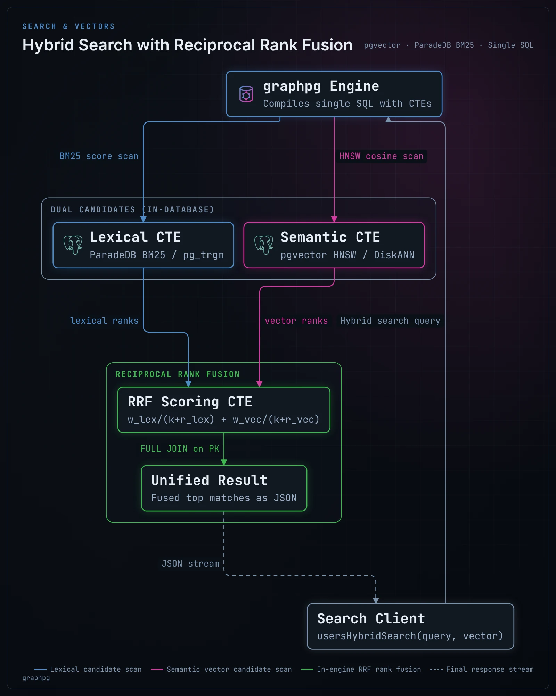

# AI agents

graphpg is useful to AI agents in two ways:

- **Agents that use your data** call typed operations on it: searches (vector, BM25, hybrid), lookups, lists and writes, as MCP tools or over HTTP, limited to what their token may see.
- **Agents that build applications** code against a contract graphpg generates from the database: the GraphQL SDL and the OpenAPI document, typed errors, and checks that fail when the two drift apart.

Both rely on the same things the rest of graphpg does: the database decides what exists and who may see it, and every request is bounded before it runs.

## Agents that use your data

### Retrieval: vector, BM25 and hybrid search

Search fields come from the indexes you create. A table with a vector index and a lexical one (BM25, or trigram) gets semantic, lexical and hybrid search, over GraphQL and REST, with no code:

```sql
CREATE TABLE documents (
    id bigint GENERATED ALWAYS AS IDENTITY PRIMARY KEY,
    tenant_id uuid NOT NULL,
    title text NOT NULL,
    body text NOT NULL,
    embedding vector(1536) NOT NULL
);
CREATE INDEX ON documents USING hnsw (embedding vector_cosine_ops);   -- semantic
CREATE INDEX ON documents USING gist (title gist_trgm_ops);           -- lexical (or a ParadeDB bm25 index)
```

```graphql
query Retrieve($embedding: [Float!]!, $tenant: UUID!) {
  documentsHybridSearch(query: "refund policy", vector: $embedding, first: 5,
                        filter: { tenantId: { equalTo: $tenant } }) {
    hits { score node { id title body } }
  }
}
```

```bash
curl -X POST localhost:4000/rest/documents/search/hybrid -H 'content-type: application/json' \
     -d '{"query": "refund policy", "vector": [0.012, -0.034, ...], "first": 5}'
```



- **Hybrid search** takes each ranking's best candidates and fuses them by reciprocal rank (`lexicalWeight`, `vectorWeight`, `rrfK`), in one SQL statement. The `filter` and `condition` scope the candidates before they are ranked, and Row-Level Security applies as for any read.
- **graphpg does not compute embeddings.** The caller embeds the query with the model that embedded the rows and passes the `vector`. An agent cannot produce a vector itself, so for an agent's tool either embed in your tool code, or expose a function: a `STABLE` SQL function that embeds in the database (an extension such as pgai) and searches becomes a query field like any other.
- Indexes of pgvector (`hnsw`, `ivfflat`), pgvectorscale (`diskann`), VectorChord, ParadeDB BM25, `pg_trgm`, PGroonga and full-text search all give search fields. See [search fields](graphql-api.md#search-fields), [REST search methods](rest-api.md#search-methods) and [extensions](extensions.md).

### MCP tools through Apollo MCP Server

graphpg does not speak the Model Context Protocol itself. [Apollo MCP Server](https://www.apollographql.com/docs/apollo-mcp-server) (MIT) does, and turns GraphQL operations against any endpoint into MCP tools: point it at graphpg's `/graphql`, give it the operations the agent may run, and each one becomes a typed tool, its inputs taken from the operation's variables.

**1. The operations.** One file per tool. The operation name is the tool's name; its variables are the tool's inputs. With the [blog example](https://github.com/mihailtd/graphpg/tree/main/examples/blog):

```graphql
# operations/SearchPosts.graphql
query SearchPosts($query: String!) {
  postsFuzzySearch(query: $query, first: 5) {
    hits { score node { id title excerpt(length: 200) } }
  }
}
```

```graphql
# operations/AddComment.graphql
mutation AddComment($postId: UUID!, $authorId: UUID!, $body: String!) {
  createComment(input: { postId: $postId, authorId: $authorId, body: $body }) {
    comment { id }
  }
}
```

**2. The schema.** The MCP server reads it from a file to type the tools. Export it from graphpg:

```bash
graphpg export-graphql --out schema.graphql
```

**3. The MCP server's configuration**, here for a local client (Claude Desktop, an IDE) over `stdio`:

```yaml
# mcp.yaml
endpoint: http://localhost:4000/graphql
transport:
  type: stdio
headers:
  Authorization: "Bearer ${env.GRAPHPG_AGENT_TOKEN}"   # the agent's own token: its role, its rows
schema:
  source: local
  path: ./schema.graphql
operations:
  source: local
  paths:
    - ./operations/SearchPosts.graphql
    - ./operations/AddComment.graphql
overrides:
  mutation_mode: explicit   # the mutations listed above, and no others
```

```json
{
  "mcpServers": {
    "graphpg": { "command": "apollo-mcp-server", "args": ["/path/to/mcp.yaml"],
                 "env": { "GRAPHPG_AGENT_TOKEN": "..." } }
  }
}
```

For a shared server, use `transport.type: streamable_http` with `transport.auth` (an OAuth resource server), and forward each user's token with `forward_headers: [authorization]`, so every call runs as the person the agent acts for. Keep `introspection.execute` off unless the agent may write its own operations; `mutation_mode` decides whether those may write. Option names follow Apollo MCP Server 2.0; see its [configuration reference](https://www.apollographql.com/docs/apollo-mcp-server/config-file).

### Guardrails

An agent is a client you trust less than your own code. What graphpg already does for any client is what bounds it:

- **Its own role and its own rows.** Give the agent a token whose role holds only the grants it needs ([authentication](authentication.md)). Row-Level Security policies decide which rows it sees and writes, per request, in the database. With `rbac.enabled`, an instance connecting as that role [serves only what it may do](federation-and-rbac.md): tools for anything else cannot even be written against its schema.
- **Bounded requests.** [Safety limits](configuration.md#safety-limits) (page size, depth, cost, `statement_timeout`) are checked on the plan before any SQL runs, so an agent cannot ask for the whole database. [Rate limits](configuration.md#rate-limits) count per token (`sub`).
- **Only listed operations.** With [persisted queries](graphql-api.md#persisted-queries) and `allow_list: true`, graphpg refuses any operation that is not in its manifest (`OPERATION_NOT_ALLOWED`), whatever the client sends, operations sent as text included when their SHA-256 is listed. Build the manifest from the same operation files the MCP server reads. This depends on the MCP server sending each operation's text unchanged; check it against your version before relying on it.
- **Errors without internals.** In production, database errors are masked (`errors.detail: masked`); typed codes (`EMAIL_TAKEN`, `PERMISSION_DENIED`, `PAGE_SIZE_EXCEEDED`) still reach the agent, which can act on them.
- **Reads off the primary.** Point an agent's instance at [read replicas](performance.md) when it only reads.

### Over REST and OpenAPI

Frameworks that build tools from an OpenAPI document can use `/openapi.json` directly: every operation has typed parameters and bodies, `CHECK` constraints appear as JSON Schema keywords, and errors are RFC 9457 problem documents with the same typed codes. Pin the document (`graphpg schema export`) so the tools change only when you deploy a change. `GET /rest/search?query=…` searches every searchable table at once. See the [REST API](rest-api.md).

### Reacting to changes

[Event triggers](events.md) post a signed webhook when rows change or on a schedule, captured in the change's own transaction: a new support ticket can start an agent run without polling. [Subscriptions](subscriptions.md) push a query's new result to a client when it changes.

## Agents that build applications

An agent writing an application needs to know what the API accepts and returns, and to find out quickly when it got something wrong. graphpg generates both from the database:

- **One contract, in files.** `graphpg schema export` writes the GraphQL SDL and the OpenAPI document; commit them. An agent reads the real types, nullability, enums, inputs and error codes instead of guessing, and code generators (GraphQL Code Generator, OpenAPI generators) turn them into typed clients.
- **Drift fails fast.** When the agent writes a migration, dev mode reloads the API and rewrites those files (`watch.export`); the typed client then fails to compile where the change broke it. In CI, `graphpg schema export --check` fails when the committed files are out of date, and production refuses to start on drift ([pinned schemas](configuration.md#pinned-schemas)).
- **Typed errors.** Constraint violations come back as codes derived from the constraint (`EMAIL_TAKEN`, `AUTHOR_NOT_FOUND`), listed per type in the schema, so generated code can handle each one. `@constraint` and the OpenAPI document state the checks a value must pass before it is sent.
- **Authorization enforced at the data layer.** When agents write application code, they routinely omit tenant filters or scoping parameters in newly created queries. PostgreSQL Row-Level Security enforces authorization directly in the database engine, ensuring that no unfiltered query generated by an AI agent can leak records across tenants or users. Auditing takes place on declarative SQL policies rather than scattered controllers. See [Why Row-Level Security Is the Only Reliable Auth for AI-Built Apps](https://mihai.ltd/blog/row-level-security-ai-coding-agents).
- **Less code to write.** There are no resolvers: the agent's work is SQL (tables, constraints, policies, functions) and client code, both of which it can test. Behaviour goes in the database, where every API sees it ([extending graphpg](extending.md)).
- **Feedback while it works.** In dev mode, `debug.sql` and `debug.explain` return the SQL a request ran and its plan; `/debug/statements` and `graphpg advise --statements` name the indexes the slowest operations lack ([performance](performance.md)). `graphpg export-config-schema` gives `graphpg.yaml` a JSON Schema of your real tables and columns, so a configuration mistake is caught by the editor.
