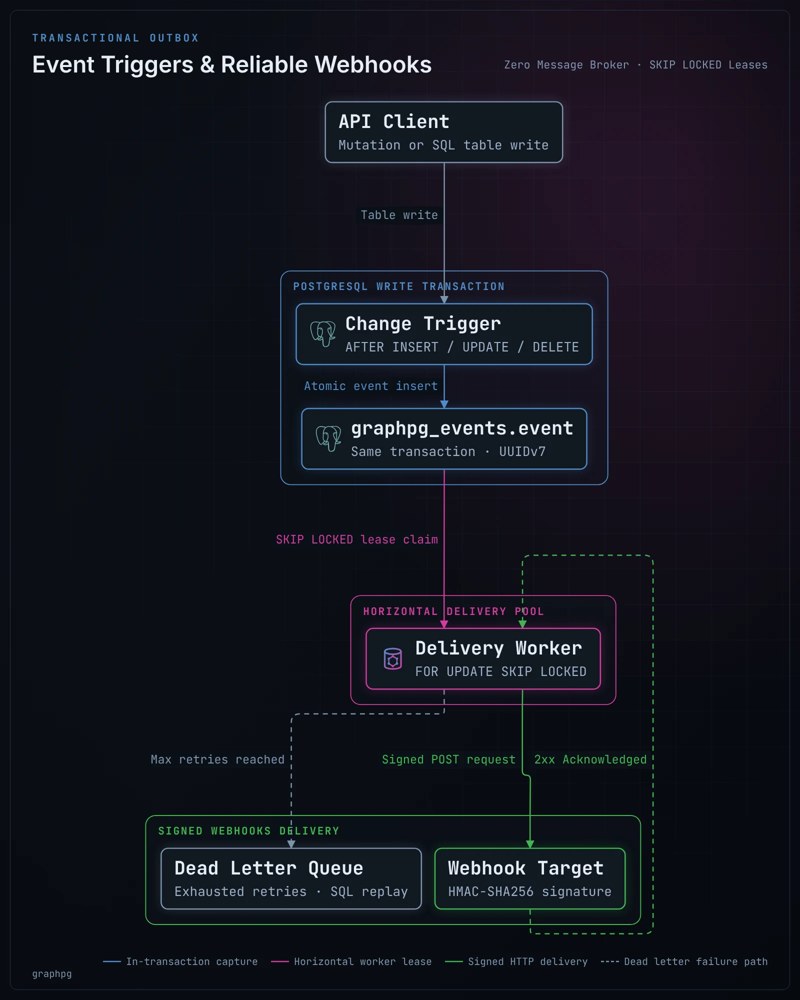

# Event triggers

graphpg calls your HTTP endpoints when rows change (**event triggers**) and on a schedule (**scheduled events**). It's the transactional outbox pattern, built from PostgreSQL alone: no message broker, no logical replication slot, no extension.

- [How it works](#how-it-works)
- [Quick start](#quick-start)
- [Change events](#change-events)
- [Scheduled events](#scheduled-events)
- [Delivery](#delivery)
- [Verifying requests](#verifying-requests)
- [Operating it](#operating-it)
- [Configuration reference](#configuration-reference)

## How it works



1. **Capture, in the change's transaction.** graphpg installs triggers on the tables you name. They write each change into its own table, `graphpg_events.event`, in the same transaction as the change. An event exists if and only if its change committed: a rolled-back write raises nothing, and a committed one cannot lose its event.
2. **Delivery, at least once.** A worker in each graphpg instance claims due events and `POST`s them to your endpoint. It wakes when a capture trigger notifies it (`NOTIFY`), when the next retry or scheduled event falls due, and at least every 5 seconds. Claims are leases taken with `FOR UPDATE SKIP LOCKED`, so any number of instances share the work without delivering an event twice. If an instance dies mid-delivery, its lease runs out and the event is delivered again.
3. **Retries, then a dead letter.** A delivery that isn't acknowledged with a 2xx is retried with exponential backoff, until `retry.max_attempts`. Then the event is `dead`: kept, inspectable and replayable with SQL.

Writes cost one extra `INSERT … SELECT` per statement (inserts and deletes) or per changed row (updates), in the writing transaction. HTTP never happens inside your transaction.

## Quick start

```yaml
events:
  triggers:
    order_changed:
      table: orders
      url: https://hooks.example.com/orders
      secret: ${ORDER_WEBHOOK_SECRET}    # whsec_… (Standard Webhooks)
  schedules:
    nightly_report:
      cron: "0 3 * * *"                  # UTC
      url: https://reports.example.com/run
      payload: { kind: nightly }
```

At startup, graphpg creates the schema `graphpg_events` (its table and functions) and the triggers on `orders`. The OpenAPI document describes each trigger and schedule under `webhooks`, with the payload's schema.

## Change events

```json
{
  "id": "01a131f5-d93b-7276-b023-efd651b8cd5b",
  "createdAt": "2026-10-13T09:12:37.946Z",
  "table": { "schema": "app", "name": "orders" },
  "op": "update",
  "old": { "id": "1", "status": "new", "total": "9.99" },
  "new": { "id": "1", "status": "paid", "total": "9.99" }
}
```

- `old` is `null` for an insert, `new` is `null` for a delete.
- **Rows are shaped as the REST API shapes them**: field names and omissions from `graphpg.yaml`, `bigint` and `numeric` as strings, enums as the API names them. It's the same code that serves `GET /rest/orders/1`. The trigger stores the row as it is (`to_jsonb`), and graphpg shapes it at delivery, so a rename in `graphpg.yaml` needs no reinstall.
- `id` is a UUIDv7 on PostgreSQL 18 (time-ordered), the same on every delivery attempt.
- **An update with no change raises nothing** (`WHEN (OLD IS DISTINCT FROM NEW)`). With `columns: [status]`, only a change of one of those columns does (`AFTER UPDATE OF status`).
- Inserts and deletes are captured **per statement**, from transition tables: inserting 10,000 rows in one statement writes 10,000 events with one `INSERT … SELECT`. `COPY` and graphpg's bulk writes and imports are captured like any insert.
- Only tables and partitioned tables can capture changes. Views and foreign tables cannot have these triggers.

## Scheduled events

```json
{ "id": "…", "createdAt": "…", "schedule": "nightly_report", "scheduledFor": "2026-10-14T03:00:00Z", "payload": { "kind": "nightly" } }
```

- `cron` is the standard 5 fields, in UTC: minute, hour, day of month, month, day of week. Each field takes `*`, values, ranges (`1-5`), steps (`*/15`) and lists. The aliases are `@hourly`, `@daily`, `@weekly`, `@monthly` and `@yearly`. As in cron, when both day fields are restricted, a day matching either one is due.
- **One event per slot, across instances.** Every instance computes the slots. A unique index on `(trigger_name, scheduled_for)` makes the first insert win and the others do nothing. There's no leader election.
- **Missed slots** (no instance running at 03:00): `catch_up: latest` (the default) sends the most recent missed slot when an instance starts; `none` skips them.
- **One-off events from SQL**, from a function, a trigger or a migration, delivered at the given time:

  ```sql
  SELECT graphpg_events.schedule('reminder', now() + interval '1 day', '{"user": 42}');
  ```

  `reminder` is a schedule in `graphpg.yaml`; it can have no `cron` at all. The call is transactional too: rolled back, nothing is sent.

## Delivery

| | |
| :--- | :--- |
| Guarantee | At least once. Receivers deduplicate on `webhook-id` (the event `id`). |
| Acknowledgement | Any 2xx within `timeout` (default 10 s). |
| Retries | Exponential backoff with jitter: about 10 s, 20 s, 40 s, … capped at `max_backoff` (1 h), until `max_attempts` (10). |
| Ordering | Best effort, by due time then id. A retried event can arrive after later ones; compare `createdAt`, or a version column of the row, when order matters. |
| Concurrency | `delivery.concurrency` requests in flight per instance (4), in batches of `delivery.batch` (50). |
| Rolling deploys | An event naming a trigger this instance doesn't know is left for an instance that does, without counting an attempt. |

## Verifying requests

Requests follow the [Standard Webhooks](https://www.standardwebhooks.com/) specification, so its libraries verify them in most languages:

```
webhook-id: 01a131f5-d93b-7276-b023-efd651b8cd5b
webhook-timestamp: 1791839557
webhook-signature: v1,g0hM9SsE+OTPJTGt/tmIKtSyZlE3uFJELVlNIOLJ1OE=
```

The signature is `base64(HMAC-SHA256(key, "{id}.{timestamp}.{body}"))`. The key is the base64 after `whsec_` in `secret`, or the secret's own bytes otherwise. Reject old timestamps to stop replays. Per-trigger `headers` are sent too, for example a static token checked by a gateway.

## Operating it

```sql
-- What is waiting, failing or dead
SELECT trigger_name, status, count(*), max(attempts), min(deliver_at)
FROM graphpg_events.event GROUP BY 1, 2;

-- Why the dead ones died
SELECT id, trigger_name, attempts, last_error FROM graphpg_events.event WHERE status = 'dead';

-- Replay them (after fixing the endpoint)
UPDATE graphpg_events.event SET status = 'pending', attempts = 0, deliver_at = now() WHERE status = 'dead';
```

- **Metrics:** `graphpg_event_deliveries_total{graphpg_event_trigger, graphpg_event_outcome}`, where the outcome is `delivered`, `retry`, `dead` or `unknown`; also over OTLP. See [observability](observability.md).
- **Retention:** delivered events are deleted after `delivery.retention` (7 days), dead ones after `delivery.dead_retention` (30 days), a thousand at a time.
- **Installing:** `events.install: auto` (the default) creates or updates everything at startup, in one transaction under an advisory lock, and drops the triggers of event triggers no longer configured. graphpg's connecting role needs to be able to create a schema and triggers on the tables. With `install: manual`, graphpg only checks: `graphpg events sql` prints the DDL for your migration tool, and in prod a missing piece stops the start.
- **Off:** `events.enabled: false`, or no triggers and no schedules, means nothing is installed, checked or delivered.
- **Read replicas:** events are claimed and recorded on the primary.

## Configuration reference

```yaml
events:
  enabled: true                 # nothing happens without triggers or schedules
  schema: graphpg_events        # graphpg's event table and functions
  install: auto                 # auto | manual (graphpg events sql)
  triggers:
    <name>:                     # lowercase, at most 40 characters
      table: orders             # or schema.table
      operations: [insert, update, delete]   # default: all
      columns: [status]         # updates: only when one of these changes
      url: https://…
      headers: { x-team: billing }
      secret: ${SECRET}         # whsec_<base64>, or any text
      timeout: 10s
      retry: { max_attempts: 10, backoff: 10s, max_backoff: 1h }
  schedules:
    <name>:
      cron: "*/15 * * * *"      # optional: without it, only schedule() from SQL
      payload: { any: json }
      catch_up: latest          # latest | none
      url: https://…            # and headers, secret, timeout, retry as above
  delivery:
    concurrency: 4
    batch: 50
    poll: 5s
    lease: 60s                  # past it, another instance may deliver a claimed event again
    retention: 7d
    dead_retention: 30d
```
