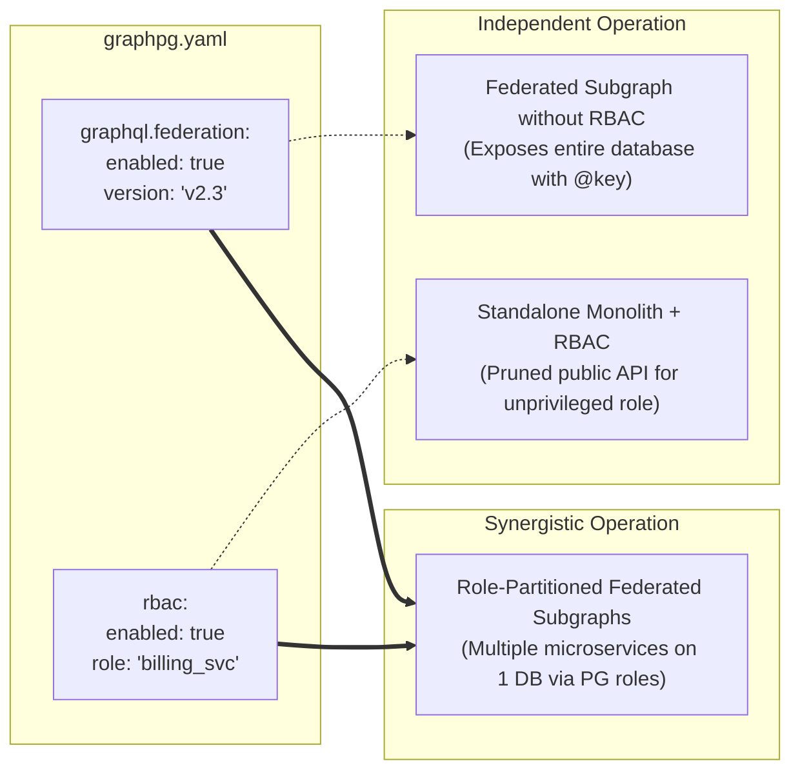
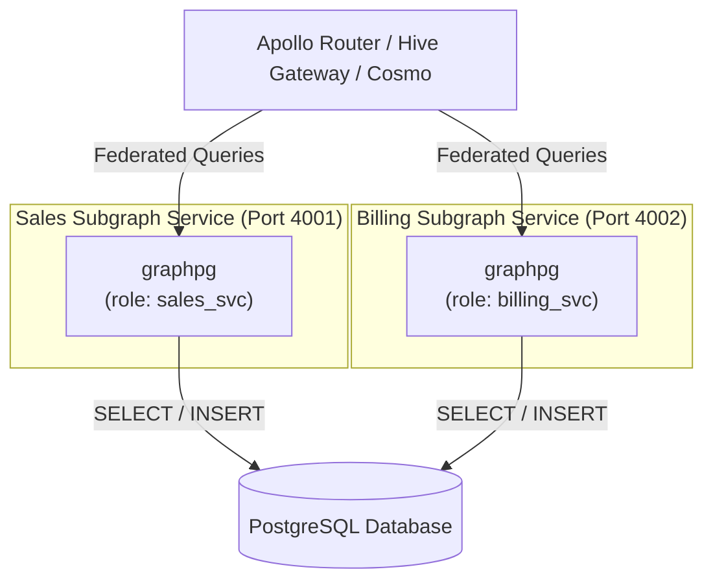

# Federation and role-based schema pruning

This guide explains how **Apollo Federation Subgraphs** and **Role-Based Schema Pruning (RBAC)** work in graphpg, how they can be used independently or combined, and what you need to configure in PostgreSQL and `graphpg.yaml` to take full advantage of them.

---

## How the two relate

Federation and RBAC address two distinct architectural concerns:



- **Can RBAC Schema Pruning work without Federation?** **Yes.** A monolithic deployment connecting with a non-admin role will have its GraphQL SDL pruned automatically.
- **Can Federation work without RBAC Schema Pruning?** **Yes.** A service connecting with admin credentials will expose all its tables as federated entities with `@key`.
- **How do they combine?** You can run multiple instances of graphpg against the same physical database, each connecting as a different PostgreSQL role. Each engine exposes only the domain that its role is granted, automatically decorated with `@key`, and Apollo Router or Hive Gateway merges them into a unified supergraph.

---

## Apollo Federation Subgraphs

### How It Works
graphpg acts as an **Apollo Federation v2.3 Subgraph**. It does not replace the router; users bring their own **Apollo Router**, **Hive Gateway**, or **Cosmo**.

#### A. Dual-SDL Architecture
The engine generates two distinct views of the GraphQL schema:
1. **Subgraph SDL (`_service { sdl }` and CLI export):**
   - Starts with the Apollo Federation v2 schema link:
     ```graphql
     extend schema
       @link(url: "https://specs.apollo.dev/federation/v2.3", import: ["@key", "@shareable"])
     ```
   - Decorates entity types with `@key(fields: "id")` (or composite primary keys).
   - Strictly conforms to the Apollo Federation specification by **omitting** all federation internal types (`_Service`, `_Entity`, `_Any`, `_FieldSet`) and query fields (`_service`, `_entities`).
2. **Runtime Engine Schema:**
   - Registers standard GraphQL declarations for `scalar _Any`, `scalar _FieldSet`, `directive @key`, `directive @shareable`, `type _Service { sdl: String! }`, and `union _Entity = ...`.
   - Mounts `Query._service` and `Query._entities(representations: [_Any!]!): [_Entity]!`.
   - Allows local GraphQL validation and execution engines (`apollo-compiler`) to validate incoming federation queries without external network calls.

#### B. Batched `_entities` execution

When the router sends a batch of representations across several types:
```graphql
query LookupEntities($reps: [_Any!]!) {
  _entities(representations: $reps) {
    __typename
    ... on Customer { id status }
    ... on Order { id reference }
  }
}
```

graphpg does not run one query per representation. Representations of the same type and key are grouped, and each group's keys are bound as a single JSON parameter and joined to the table's lookup (`jsonb_to_recordset`), so a batch costs **one lookup per type and key**, all inside one SQL statement. Positions are preserved in the result:

```sql
SELECT coalesce(json_agg(e.data ORDER BY s.ord), '[]'::json)
FROM generate_series(0, $3 - 1) AS s(ord)
LEFT JOIN (
  SELECT k."ord", (SELECT json_build_object('__typename', 'Customer', 'id', c.id, 'status', c.status)
                   FROM customers c WHERE c.id = k."k0") ::json
  FROM jsonb_to_recordset($1::jsonb) AS k("ord" int4, "k0" uuid)
  UNION ALL
  SELECT k."ord", (SELECT json_build_object('__typename', 'Order', 'id', o.id, 'reference', o.reference)
                   FROM orders o WHERE o.id = k."k0")::json
  FROM jsonb_to_recordset($2::jsonb) AS k("ord" int4, "k0" uuid)
) AS e(ord, data) ON e.ord = s.ord
```

(Simplified: the generated SQL differs in aliases and casts.)

- **Resilience:** an entity that does not exist, an unknown type or a malformed key yields `null` at its position (`[ { ... }, null, { ... } ]`), as the federation specification requires, without failing the query.
- **Relay global IDs:** keys may be raw database keys or base64 Relay global IDs (`Customer:123`).

---

## Role-Based Schema Pruning (RBAC)

### How It Works
Rather than maintaining a custom permissions DSL or metadata rules inside the GraphQL engine, graphpg uses **PostgreSQL itself as the single source of truth**.

During introspection, the engine queries PostgreSQL's native catalog functions:
- `has_table_privilege(table_oid, 'SELECT | INSERT | UPDATE | DELETE')`
- `has_column_privilege(table_oid, attnum, 'SELECT | INSERT | UPDATE')`

### Pruning Rules

| PostgreSQL Privilege State | Generated GraphQL Schema Impact |
| :--- | :--- |
| **No privileges on a table** | Table is **completely removed** from the schema. No object types, query fields, or mutation fields are generated. |
| **`GRANT SELECT` only (Read-Only Table)** | Table object type, list field (`customers`), single lookup (`customer`), and connection (`customersConnection`) exist. **All mutation fields (`createCustomer`, `updateCustomer`, `deleteCustomer`) are pruned.** |
| **`GRANT INSERT` only (Write-Only Table)** | Queries and connections are pruned. Only the `create<Type>` mutation is generated. |
| **`GRANT SELECT, INSERT` (No `UPDATE` or `DELETE`)** | Read queries and `create<Type>` exist. `update<Type>` and `delete<Type>` are pruned. |
| **Column-Level `REVOKE SELECT (col)`** | Column is marked `omit: true` and excluded from every GraphQL output type and filter. |
| **Column-Level `GRANT SELECT` without `UPDATE`** | Column is marked `readonly: true`. It is visible in queries, but excluded from `Create<Type>Input` and `Update<Type>Input`. |
| **Relations & Functions to Pruned Tables** | Any foreign key relation, many-to-many junction, computed column, or mounted function pointing to a pruned table is automatically pruned. |

---

## Configuration

Both features are configured in `graphpg.yaml`:

```yaml
# 1. Federation Subgraph Settings
graphql:
  federation:
    enabled: true     # Turn on Apollo Federation Subgraph mode (default: false)
    version: "v2.3"   # Federation spec version (default: "v2.3")

# 2. Role-Based Schema Pruning (RBAC) Settings
rbac:
  enabled: true       # Turn on schema pruning by PostgreSQL grants (default: false)
  role: "customer_svc" # Optional: Issue SET ROLE during inspection (default: connects as DB user)

# Optional Entity Overrides
entities:
  customers:
    key_fields: "id"  # Override @key fields (defaults to primary key)
    shareable: true   # Add @shareable directive to this type
```

### CLI Subcommands
- **Export Federation Subgraph SDL:**
  ```bash
  graphpg export-subgraph --out subgraph.graphql
  ```
  Exports the federation SDL ready for Apollo Rover (`rover subgraph publish`) or Hive Gateway.
- **Export Monolithic GraphQL SDL:**
  ```bash
  graphpg export-graphql --out schema.graphql
  ```

---

## Walkthroughs

### Scenario A: Standalone Monolith with an Unprivileged Role
Suppose you want to expose a public GraphQL API where anonymous users can read forums and create messages, but cannot delete anything or view users' private email addresses.

#### Configure PostgreSQL
```sql
-- Create an application role
CREATE ROLE api_public_user;

-- Grant access to the schema
GRANT USAGE ON SCHEMA app_public TO api_public_user;

-- 1. Forums: Read-only
GRANT SELECT ON app_public.forums TO api_public_user;

-- 2. Messages: Read and Insert, but NO Update or Delete
GRANT SELECT, INSERT ON app_public.messages TO api_public_user;

-- 3. Users: Column-level access (hide sensitive email and password)
GRANT SELECT (id, username, created_at) ON app_public.users TO api_public_user;
```

#### Configure `graphpg.yaml`
```yaml
rbac:
  enabled: true
  role: "api_public_user"
```

#### Resulting GraphQL Schema
- `forums`, `messages`, and `users` are queryable.
- `createMessage` mutation is available.
- `deleteMessage`, `updateMessage`, `createForum`, `deleteForum`, `createUser`, `updateUser` do **not** exist in the schema.
- `User` type has `id`, `username`, and `createdAt`. The `email` and `passwordHash` fields do **not** exist in the schema.

---

### Scenario B: Role-Partitioned Subgraphs (The Microservice Pattern)
Suppose you have a unified database with sales tables (`customers`, `orders`) and billing tables (`payments`, `invoices`). You want two independent microservice subgraphs running in separate containers, composed by Apollo Router.



#### Configure PostgreSQL Roles
```sql
-- Create microservice roles
CREATE ROLE sales_svc;
CREATE ROLE billing_svc;

GRANT USAGE ON SCHEMA public TO sales_svc, billing_svc;

-- Sales Service owns Customers and Orders
GRANT ALL PRIVILEGES ON TABLE public.customers, public.orders TO sales_svc;

-- Billing Service owns Payments and Invoices
GRANT ALL PRIVILEGES ON TABLE public.payments, public.invoices TO billing_svc;

-- If Billing Service needs to reference Customers by ID:
GRANT SELECT (id) ON TABLE public.customers TO billing_svc;
```

#### Configure Subgraph 1: Sales Service (`sales.config.yaml`)
```yaml
graphql:
  federation:
    enabled: true
rbac:
  enabled: true
  role: "sales_svc"
```
Run with:
```bash
PORT=4001 ENGINE_CONFIG=sales.config.yaml graphpg
```
*Result:* Exposes `Customer` and `Order` entities with `@key(fields: "id")` and full queries/mutations. `payments` and `invoices` are pruned.

#### Configure Subgraph 2: Billing Service (`billing.config.yaml`)
```yaml
graphql:
  federation:
    enabled: true
rbac:
  enabled: true
  role: "billing_svc"
```
Run with:
```bash
PORT=4002 ENGINE_CONFIG=billing.config.yaml graphpg
```
*Result:* Exposes `Payment` and `Invoice` entities with `@key(fields: "id")` and full queries/mutations. Exposes stub `Customer` entity containing only `id` with `@key(fields: "id")`.

#### Compose via Apollo Router (`supergraph.yaml`)
```yaml
subgraphs:
  sales:
    routing_url: http://localhost:4001/graphql
    schema:
      subgraph_url: http://localhost:4001/graphql
  billing:
    routing_url: http://localhost:4002/graphql
    schema:
      subgraph_url: http://localhost:4002/graphql
```
Apollo Router composes both subgraphs into a single unified supergraph. When clients query:
```graphql
query GetCustomerWithPayments($id: ID!) {
  customer(id: $id) {
    name
    payments {
      totalAmount
    }
  }
}
```
The router fetches `customer.name` from Subgraph 1 (Port 4001) and issues an `_entities` lookup to Subgraph 2 (Port 4002) for the payments. Both subgraphs execute single SQL queries against PostgreSQL under their respective role grants.
