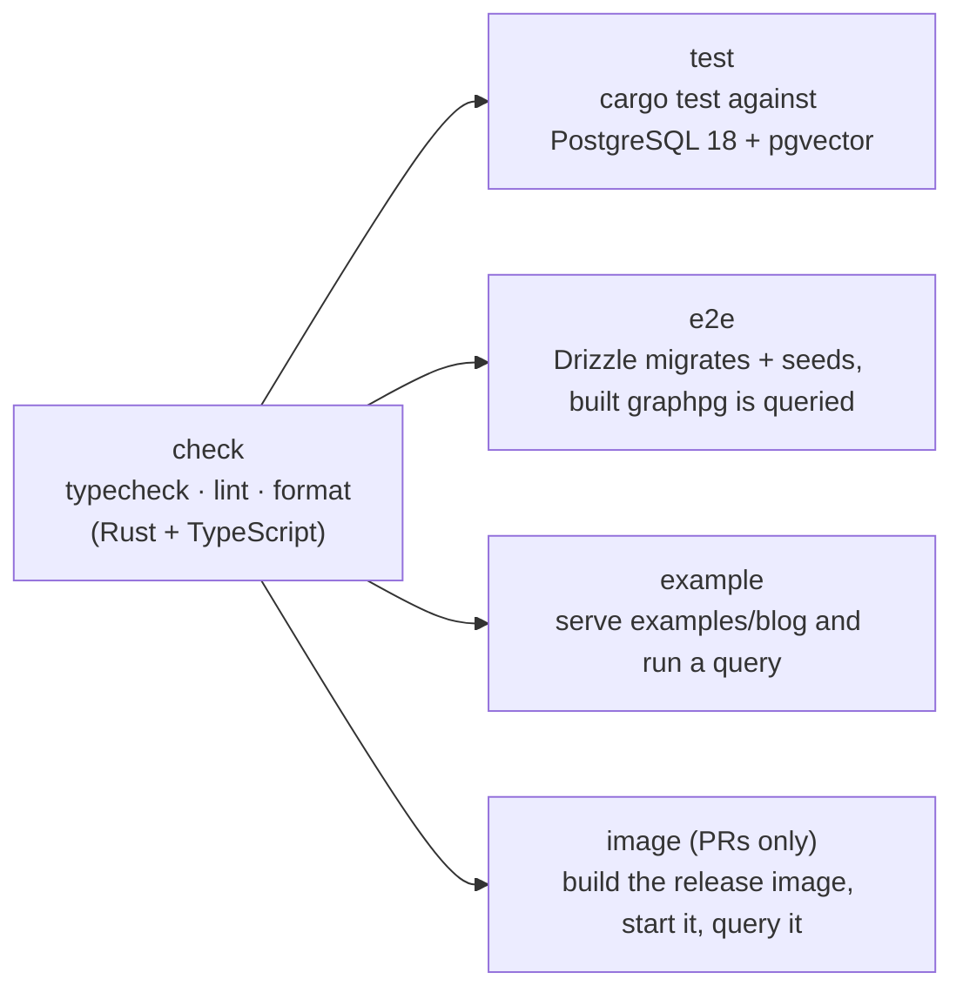
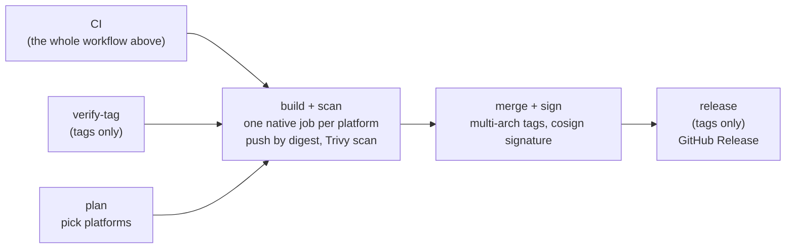

# Pipelines

How code gets checked, built and released. The workflows live in [`.github/workflows/`](../.github/workflows); the task definitions they call live in the [moon](https://moonrepo.dev) projects ([`crates/graphpg/moon.yml`](../crates/graphpg/moon.yml), [`e2e/moon.yml`](../e2e/moon.yml)), so anything CI runs can be run locally with the same command.

| Trigger | Workflow | What happens | Publishes? |
|---|---|---|---|
| Pull request (any branch) | CI | static checks, tests, example, container build | no |
| Push to `main` | Publish (runs CI first) | everything above, then build, scan, tag, sign | image `:edge`, `:sha-…` |
| Tag `vX.Y.Z` | Publish (runs CI first) | as for `main`, plus tag verification and a GitHub Release | image `:X.Y.Z`, `:X.Y`, `:X`, `:latest` |
| Weekly | Dependabot | opens PRs for Cargo, npm, GitHub Actions and Docker updates | no |

Branches never publish an image: a pull request only builds and tests.

## CI (`ci.yml`)

Runs on pull requests and manually, and is called by Publish before anything is released.

- **check** runs first and everything else waits for it, so a formatting or type error fails in about a minute rather than after the long jobs. It runs `moon run :typecheck :lint :format`: `cargo check`, `clippy -D warnings` and `cargo fmt --check` for Rust, `tsc` and Biome for TypeScript. Locally: `pnpm verify`, and `pnpm fix` to apply the fixes.
- **test** runs the Rust integration tests against a real PostgreSQL service container.
- **e2e** runs `moon run e2e:typecheck e2e:test`. moon installs the pinned toolchains (`.moon/toolchains.yml`), builds the `graphpg` binary, then the vitest suite uses Drizzle to migrate and seed the database, starts the binary and sends GraphQL requests to it.
- **example** starts graphpg against `examples/blog` and checks the documented query returns data.
- **image** (pull requests only) builds the production Dockerfile without pushing, runs the container against PostgreSQL and checks it serves and shuts down cleanly. It catches a broken Dockerfile before it reaches `main`.

## Publish (`publish.yml`)

Runs on pushes to `main` and on `v*` tags. A newer push to a branch cancels the run in progress; tag runs are never cancelled.

1. **CI** must pass. Nothing below runs if it fails.
2. **verify-tag** (tags only) refuses a tag that is not on `main` or whose version differs from `Cargo.toml`.
3. **plan** chooses the platforms: `linux/amd64` always, and `linux/arm64` only when the repository is public (arm64 runners are free for public repositories only).
4. **build** builds one image per platform on a native runner and pushes it by digest, without a tag. The image is scanned with Trivy for fixable HIGH and CRITICAL vulnerabilities before any tag exists; a finding fails the run and nothing is tagged.
5. **merge** combines the per-platform images into one multi-arch image, applies the tags and signs it with keyless [cosign](https://docs.sigstore.dev/) (the workflow's OIDC identity).
6. **release** (tags only) creates the GitHub Release with the image digest, the `cosign verify` command and notes generated from merged pull requests, grouped by label ([`release.yml`](../.github/release.yml)).

Tags: `main` gets `:edge` and `:sha-<short hash>`. A release tag `vX.Y.Z` gets `:X.Y.Z`, `:X.Y`, `:X` and `:latest`; a pre-release suffix (`v1.1.0-rc.1`) gets a GitHub pre-release and only its exact version tag.

### Container build caching

The Dockerfile compiles dependencies in their own layer, against stand-in sources, before copying the real source. That layer changes only when `Cargo.toml` or `Cargo.lock` does, and the GitHub Actions layer cache (`cache-from`/`cache-to type=gha`) keeps it between runs, so a source-only change recompiles just the `graphpg` crate instead of every dependency.

## Dependabot (`dependabot.yml`)

Weekly update PRs for Cargo (minor and patch grouped), npm (minor and patch grouped), GitHub Actions (grouped) and the Docker base images. Security updates are enabled for the repository. Dependabot PRs run the same CI as any other pull request. Actions are pinned by commit SHA and base images by digest, and Dependabot keeps the pins current.

`pnpm-workspace.yaml` overrides `esbuild` to a patched version because `drizzle-kit` pins older ones with known advisories; remove the override once drizzle-kit ships a patched esbuild.

## Releasing

See [CONTRIBUTING.md](../CONTRIBUTING.md#releasing): bump the version in `Cargo.toml`, merge to `main`, tag that commit.
