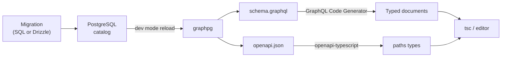

# End-to-end type safety

A column changes in PostgreSQL, and the TypeScript that reads it stops compiling where it used the old name. That is the loop this page sets up: the database schema is the only source of types, graphpg turns it into a GraphQL SDL and an OpenAPI 3.1 document, code generators turn those into TypeScript, and the type checker finds what a migration broke.

It matters most when a coding agent makes the change. Asked to "rename this everywhere", an agent in a large repository finds most of the places with search and misses a few. With the types derived from the database, the misses are compile errors it reads and fixes in the same session.

## The chain



1. **The schema is SQL.** Write it by hand or with a migration tool such as Drizzle; graphpg reads the catalog, not the tool.
2. **graphpg writes the contract.** In dev mode it watches DDL and rewrites the files named under `export:` after every change (`watch.export`, on by default).
3. **Generators write the types.** GraphQL Code Generator validates every operation in the app against `schema.graphql`; openapi-typescript turns `openapi.json` into a `paths` type for openapi-fetch.
4. **The type checker reports what broke.** Every field, filter, order option and column name in the client code is checked against the database as it is now.

## Setting it up

### graphpg

```yaml
# graphpg.yaml
export:
  graphql: schema.graphql
  openapi: openapi.json
```

```bash
graphpg --mode dev        # watches DDL, rewrites both files on every change
```

### GraphQL: GraphQL Code Generator

```ts
// codegen.ts
import type { CodegenConfig } from "@graphql-codegen/cli";

const config: CodegenConfig = {
  schema: "schema.graphql",
  documents: ["src/**/*.{ts,tsx}", "!src/gql/**/*"],
  generates: { "src/gql/": { preset: "client" } },
};
export default config;
```

```ts
import { graphql } from "./gql";

export const PatientList = graphql(`
  query PatientList {
    patientsConnection(first: 20, orderBy: [FAMILY_ASC]) {
      nodes { id family given birthDate }
    }
  }
`);
```

The result type of `PatientList` is generated from the selection, so `p.family` is a `string | null` and `p.famly` is an error.

### REST: openapi-typescript and openapi-fetch

```bash
npx openapi-typescript openapi.json -o src/api.d.ts
```

```ts
import createClient from "openapi-fetch";
import type { paths } from "./api";

// list the JSON media types: a list also answers in NDJSON and CSV
const api = createClient<paths, "application/json" | "application/problem+json">({
  baseUrl: "http://localhost:4000",
});

const { data, error } = await api.GET("/rest/patients", {
  params: { query: { fields: ["id", "family", "given"], first: 20 } },
});
```

Paths, query parameters, bodies and responses are typed. Column names in `fields`, the `order` options and the error body (`application/problem+json` with its typed `code`) come from the document, so a string literal naming a column is checked too.

### Keeping the types current

Run both generators in watch mode next to `graphpg --mode dev`, or on save. With the files in the repository, one `package.json` script covers both:

```json
{
  "scripts": {
    "codegen": "graphql-codegen --config codegen.ts && openapi-typescript openapi.json -o src/api.d.ts",
    "codegen:watch": "graphql-codegen --config codegen.ts --watch"
  }
}
```

## What a rename looks like

Measured on a FHIR R5 schema modelled with Drizzle (177 tables, a 4.3 MB SDL and a 38 MB OpenAPI document), graphpg 1.1.0 in dev mode, on one workstation. The Drizzle change:

```diff
 export const patients = pgTable("patients", {
-  family: text("family"),
+  familyName: text("family_name"),
```

`drizzle-kit generate` writes `ALTER TABLE "patients" RENAME COLUMN "family" TO "family_name";`. Once it is applied:

| Step | Time |
| :--- | :--- |
| Migration committed → `schema.graphql` rewritten | 0.63 s |
| Migration committed → `openapi.json` rewritten | 0.98 s |
| `graphql-codegen` validates the operations | 4.8 s |
| `openapi-typescript` (470,089 lines of types) | 5.3 to 6.1 s |
| `tsc` (TypeScript 7) | 0.3 s |

GraphQL Code Generator refuses the operation and names the new values:

```text
✖ Generate [FAILED: GraphQL Document Validation failed with 2 errors;
  Error 0: Value "FAMILY_ASC" does not exist in "PatientOrderBy" enum.
           Did you mean the enum value "ACTIVE_ASC", "FAMILY_NAME_ASC", or "ID_ASC"?
  Error 1: Cannot query field "family" on type "Patient".
```

The REST client stops compiling, on the property and on the string literal in `fields`:

```text
src/patients-rest.ts(8,39): error TS2322: Type '"family"' is not assignable to type
  '"active" | "address" | "birthDate" | ... | "familyName" | "fullName" | ...'.
src/patients-rest.ts(11,31): error TS2339: Property 'family' does not exist on type ...
```

Smaller schemas generate faster; the two generators dominate the time, not graphpg.

## Where the chain stops

Types cover what crosses the API. Two places sit outside it.

**SQL function bodies written as strings.** A function declared with `AS $$ … $$` is stored as text, so renaming a column it reads does not change it and nothing fails until it runs. In the measurement above, `Patient.fullName` (a computed column reading `p.family`) kept its type, `String`, and failed at run time. Write functions with a SQL-standard body instead: PostgreSQL parses it when it is created, records which columns it uses, follows a rename and refuses to drop a column it depends on.

```sql
CREATE FUNCTION patient_full_name(p patients) RETURNS text
  LANGUAGE sql STABLE
  RETURN coalesce(p.family_name, '') || ', ' || coalesce(p.given, '');

ALTER TABLE patients RENAME COLUMN family_name TO surname;   -- the body now reads (p).surname
ALTER TABLE patients DROP COLUMN surname;
-- ERROR: cannot drop column surname of table patients because other objects depend on it
```

PL/pgSQL bodies are always text: test them, or call them from tests that run after each migration.

**JSON columns.** A `jsonb` column is `JSON` in GraphQL and an untyped value in OpenAPI. Give structured values a composite type or a domain when their shape matters to the client.

## In CI and production

The exported files belong in the repository. `graphpg schema export --check` fails CI when they are out of date, so a migration cannot merge without the contract it produces, and the client code that compiled against it. In production, `export.pin: fail` (the default) refuses to start on a database that does not match the files ([pinned schemas](configuration.md#pinned-schemas)).

## Notes on tooling

- openapi-typescript 7 uses the TypeScript compiler API, which TypeScript 7 (the native compiler) does not ship in JavaScript. Keep `typescript@5` in the project for the generator and run `tsc` from TypeScript 7 under an alias (`"ts7": "npm:typescript@7"`) if you want its speed.
- A list endpoint answers in JSON, NDJSON and CSV, so openapi-fetch types the response as a union of the three unless the client names its media types, as in the example above.
- For GraphQL, an editor extension that reads `schema.graphql` (GraphQL: Language Feature Support, with a `graphql.config.ts`) can flag a stale field once graphpg rewrites the file, before code generation runs.
